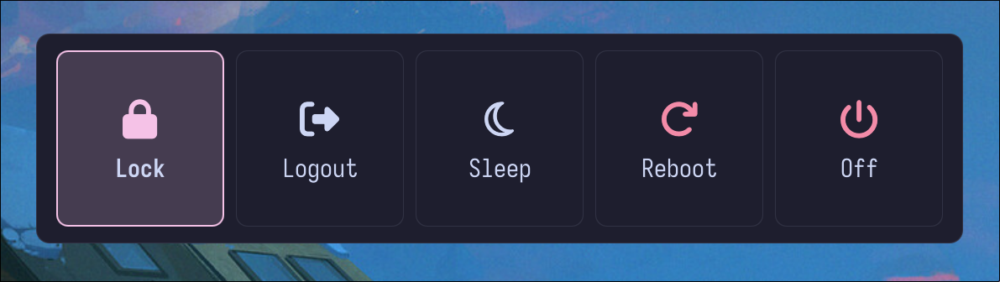

# rosepowermenu
A (cool) powermenu.


## requirements

- **linux + wayland** — rosepowermenu is intended for wayland desktops.
- **[quickshell](https://github.com/quickshell-mirror/quickshell)** — required to run the bar.
- **a compatible wayland compositor** — workspace and window-title features depend on compositor support. (MangoWM used for testing)
- **coreutils** — used by the installer for file operations.

some modules may require additional system utilities or services, depending on how they are implemented. make sure any tools used by your configuration are installed and available in your `PATH`.

## installation

clone the repository and run the installer:

```bash
git clone https://github.com/sappyware/rosepowermenu.git
cd rosepowermenu
chmod +x install.sh
./install.sh
```

the installer copies the QML files into `~/.config/quickshell/rosepowermenu/`.

## running

start rosepowermenu with:

```bash
qs -c rosepowermenu
```

to stop it, use:

```bash
qs -c rosepowermenu kill
```
example usage in MangoWM:
```bash
exec_once=qs -c rosepowermenu
```
and
```bash
bind=SUPER,p,spawn,qs -c rosepowermenu ipc call power toggle
```

## configuration
config file is located at ```~/.config/rosepowermenu/config.toml```
```bash

# catppuccin-mocha | catppuccin-latte | nord | gruvbox | tokyonight | rose-pine | dracula
theme = "catppuccin-mocha"

[font]
family = "IosevkaTerm Nerd Font Mono"   # needs nerd font glyphs for the icons
fallback = ["Symbols Nerd Font Mono", "monospace"]
size = 22                                # used when icon_size / label_size are 0
weight = "normal"                        # "normal", "bold" or a number (100-900)
italic = false

[layout]
# order of buttons. a name must exist in [actions] to show up.
buttons = ["lock", "logout", "suspend", "reboot", "shutdown"]

[overlay]
dim = 0.55         # backdrop darkness, 0.0-1.0
radius = 16        # card corner radius
padding_x = 24
padding_y = 20
gap = 14           # space between buttons

[button]
width = 100
height = 110
radius = 14
icon_size = 36     # 0 = derive from font.size
label_size = 13    # 0 = use font.size
padding_y = 14
confirm_dangerous = true   # logout/reboot/shutdown need a second press within 3s

[animation]
# focus highlight
style = "slide"            # "slide" (one highlight glides) | "fade"
focus_ms = 180             # 0 = instant
easing = "OutCubic"        # see easing list below

# opening animation
open_style = "expand"      # expand | glide | pop | fade | none
open_ms = 240              # 0 = no animation
open_easing = "OutCubic"
open_offset = 28           # px the card rises (glide only)
open_scale = 0.94          # start scale (glide / pop), 1 = none

# "tv off" effect, plays before the command runs
tv_off = true
tv_off_actions = ["suspend", "reboot", "shutdown"]
tv_off_ms = 380            # bars closing
tv_line_ms = 220           # line shrinking to a dot
tv_easing = "InOutCubic"
tv_hold_ms = 2500          # stay black after the command (reboot/shutdown)
tv_color = "#000000"
tv_line_color = "#ffffff"

# easings: Linear InQuad OutQuad InOutQuad InCubic OutCubic InOutCubic InQuart
#          OutQuart InOutQuart OutExpo InOutExpo OutSine InOutSine OutBack
#          InOutBack OutElastic OutBounce

# every action is a shell command, swap in your own tools
[actions]
lock = "lock"
logout = "mmsg dispatch quit"
suspend = "systemctl suspend"
reboot = "systemctl reboot"
shutdown = "systemctl poweroff"

[labels]
lock = "Lock"
logout = "Logout"
suspend = "Sleep"
reboot = "Reboot"
shutdown = "Off"

[icons]
lock = "\uf023"
logout = "\uf2f5"
suspend = "\uf186"
reboot = "\uf01e"
shutdown = "\uf011"

# color overrides on top of the theme. uncomment what you want.
# keys: bg fg border muted accent accent_fg urgent
[colors]
# bg = "#1e1e2e"
# fg = "#cdd6f4"
# border = "#313244"
# muted = "#9399b2"
# accent = "#f5c2e7"
# accent_fg = "#1e1e2e"
# urgent = "#f38ba8"

# per-button icon color
# [button_colors.reboot]
# fg = "#fab387"

```

## help me fix any bugs with PRs!
